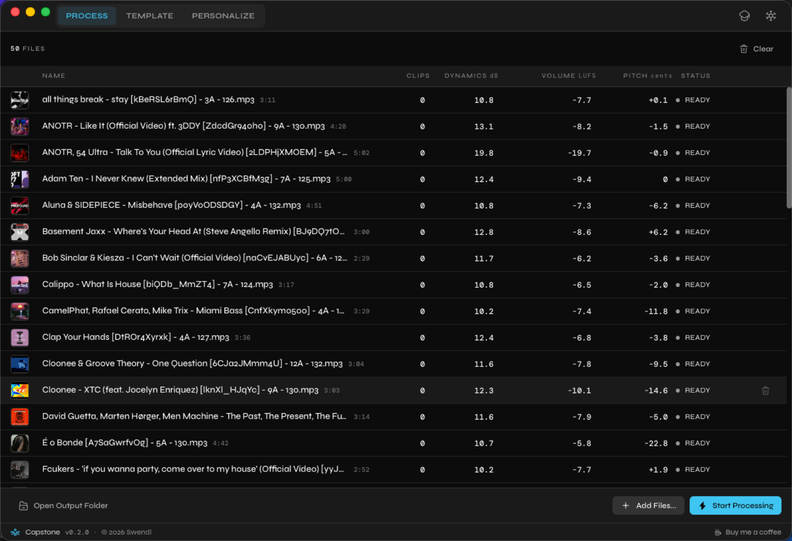

# Capstone


<!-- Screenshot placeholder: export the Process Audio Files tab at 2400x1640
     and save it as docs/screenshot.png. -->


**Your library, at one volume.** Drop in a folder of finished tracks and Capstone
hands them back level with each other, with clipped peaks repaired and the tags
still on them. Nothing leaves your machine, nothing touches the originals.

Half a DJ set is a volume fader. A 1994 CD rip sits ten decibels under last
month's promo, and you find out about it in front of people. Capstone fixes that
in a batch, offline, while you do something else.

## What it does

- **One loudness for everything.** Every file lands on the same target, measured
  the way broadcast measures it, with a true-peak limiter so nothing distorts on
  the way there.
- **Repairs clipped peaks.** Finds the flattened transients a loud master or a
  bad rip left behind and puts a plausible curve back where the top was cut off.
- **Fixes tracks that sit off pitch.** Vinyl rips and tape transfers drift from
  concert pitch. Capstone measures how far and corrects it, keeping the tempo or
  moving it with the pitch, your choice.
- **Optional warmth.** A gentle or a tube saturation stage, driven at a fixed
  level so it does the same thing to a quiet rip as to a loud one.
- **Multiband dynamics** if you want them, four bands you can move.
- **Templates.** Save a set of settings, give it a name, use it on everything.
  **Festival** ships ready to use.
- **Reads what you own, writes what you want.** In: WAV, AIFF, FLAC, MP3, M4A,
  AAC, ALAC, CAF, OGG, Opus. Out: AIFF, WAV, FLAC, ALAC or MP3.
- **Keeps your tags.** Artist, title, album, genre and the rest ride through, so
  nothing comes back needing to be identified by ear.
- **Never overwrites.** Processed files are written somewhere new. Your originals
  are untouched.

## Install

Grab the latest build from the [releases page](../../releases): a `.dmg` for
macOS, an installer for Windows.

On macOS, if you see _"Capstone is damaged and can't be opened"_, run this once:

```bash
xattr -rd com.apple.quarantine /Applications/Capstone.app
```

That warning appears because the app is not notarized with Apple yet. The command
removes the quarantine flag macOS puts on downloaded files.

## Using it

1. Drag files or a whole folder onto the **Process Audio Files** tab. Capstone
   starts measuring straight away, so you can see what is in there before you
   commit to anything.
2. Pick a template on **Configure Template**, or duplicate **Festival** and
   change it.
3. Choose where the output goes and in what format on **Personalize**.
4. Press **Start Processing**.

## Build from source

You need [Node.js](https://nodejs.org) 20+, npm, and
[Rust](https://rustup.rs) 1.87+. On macOS also the Xcode command line tools
(`xcode-select --install`).

```bash
npm install
npm run tauri dev      # run it
npm run tauri build    # build an installer
```

Settings and templates are two JSON files in the standard app data directory:

- macOS: `~/Library/Application Support/app.capstone.desktop/`
- Windows: `%APPDATA%\app.capstone.desktop\`
- Linux: `~/.local/share/app.capstone.desktop/`

## Open source

Capstone is MIT licensed — see [LICENSE](LICENSE). Every dependency is permissive
too, so you can read it, fork it, and ship your own build without asking anybody.

Issues and pull requests are welcome. If you are going to work on the audio
engine, read the project context file in the repository root first: it explains
why the processing stages run in the order they do, which is the part that is easy
to get wrong.
